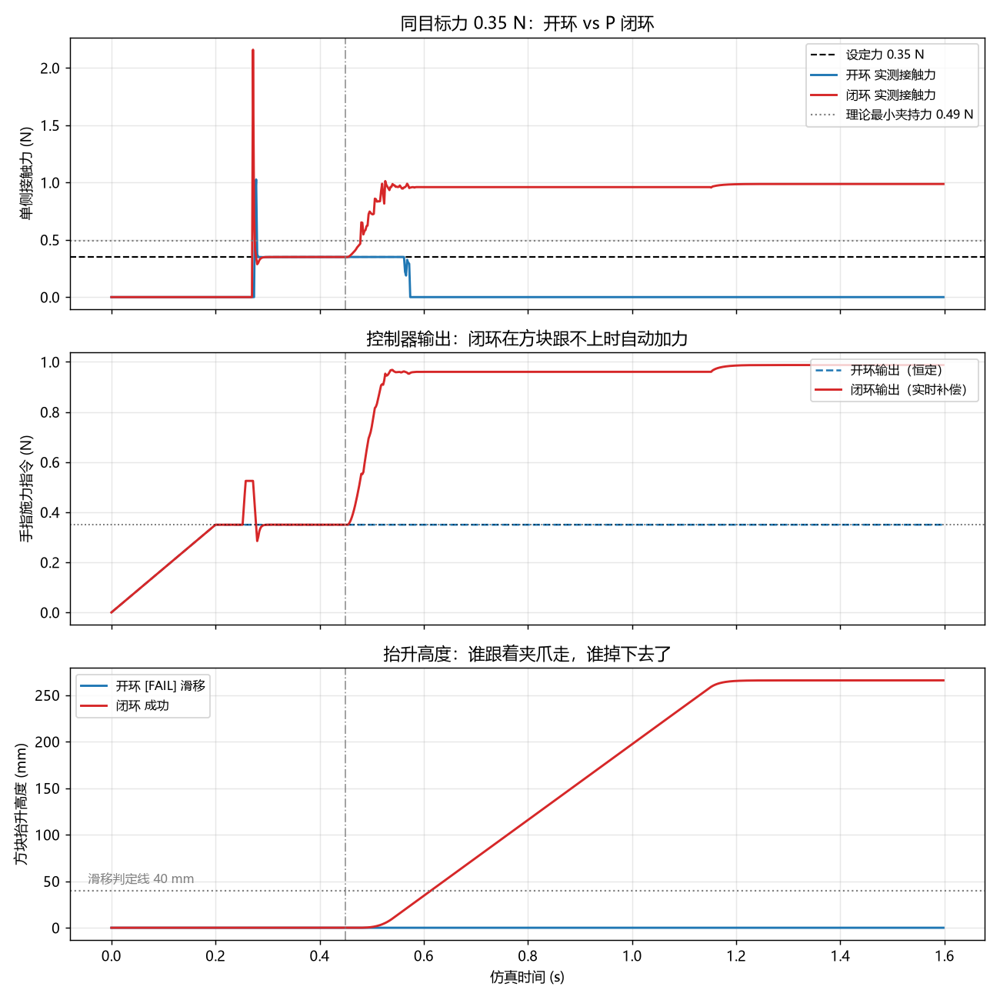
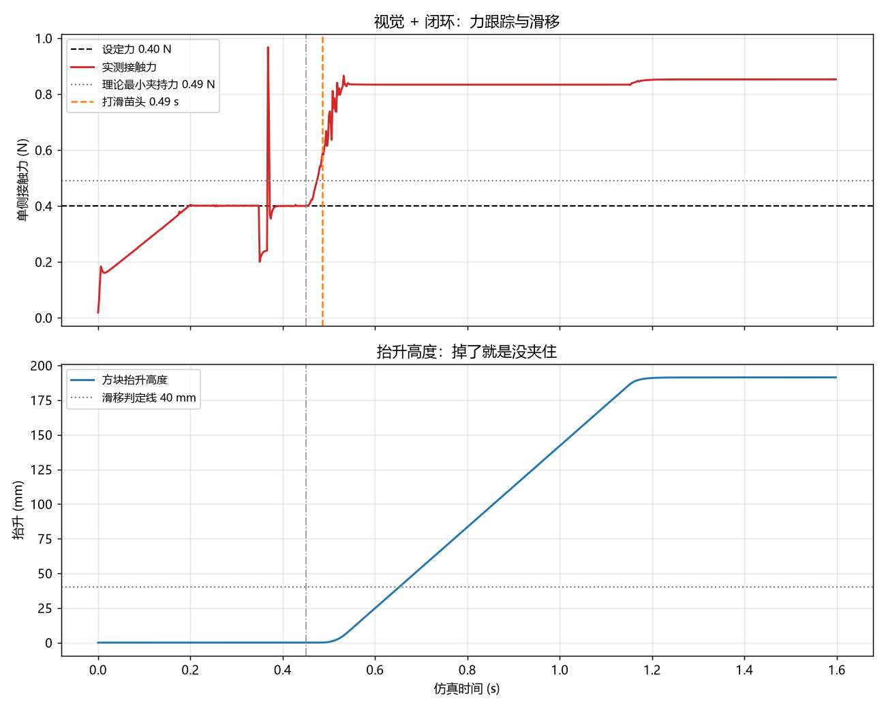

# 夹爪抓取仿真：从位置控制到视觉 + 闭环力控

> PyBullet + Franka Panda 的抓取实验，四个阶段递进：能夹起来 → 看得见 → 有力感知 → 视觉与力控串联。
> A PyBullet study of robotic grasping: position control, vision-based target localization, force control, and a closed-loop vision + force pipeline.



## 这个项目做了什么

一条从"能动"到"能感知"的完整链路，每一层都可以单独跑、单独验证：

| 脚本 | 内容 | 关键点 |
|---|---|---|
| `01_最小抓取.py` | 无视觉，方块位置写死，机械臂过去夹起来 | 逆运动学求解、夹爪开合 |
| `02_加视觉.py` | 相机拍照 → 找红色方块 → 像素反投影成世界坐标 → 过去抓 | 相机模型、射线与平面求交 |
| `03_力控.py` | 手指改为力矩控制，边施力边测真实接触力，扫 5 档夹持力 | `getContactPoints`、摩擦与临界夹持力 |
| `04_闭环力控.py` | 加入 P 反馈 + 滑移补偿，同一目标力下对比开环/闭环 | 反馈控制、增益整定、离散稳定性 |

`02_加视觉.py` 后来升级成了串联版：视觉定位 + 力控夹持放在同一条链路里，用一个开关在开环 / 闭环之间切换，不维护两份代码。

## 结果

**力跟踪与滑移**（方块 0.1 kg，摩擦系数 1.0，理论最小夹持力 0.49 N）：

| 目标力 | 接触点 | 峰值接触力 | 保持段实测 | 抬升 | 判定 |
|---|---|---|---|---|---|
| 0.30 N | 4 | 0.88 N | 0.00 N | 0.0 mm | 滑脱 |
| 0.50 N | 5 | 1.70 N | 0.00 N | 0.0 mm | 滑脱 |
| 0.80 N | 7 | 2.91 N | 0.80 N | 279.0 mm | 成功 |
| 1.20 N | 6 | 2.59 N | 1.20 N | 285.0 mm | 成功 |
| 2.00 N | 2 | 3.42 N | 2.00 N | 285.0 mm | 成功 |

实测临界值落在 0.5~0.8 N 之间，与理论值 `m*g/(2*mu)` = 0.49 N 吻合；夹住之后接触力与设定值的偏差为 0.00 N。

**开环 vs 闭环**（同一目标力 0.40 N，低于临界值，方块随机位置固定）：

| 指标 | 开环 | 闭环（P + 滑移补偿） |
|---|---|---|
| 打滑苗头 | 0.49 s | 0.49 s |
| 夹持维持时长 | 0.04 s | 1.15 s |
| 力跟踪误差（指令 vs 实测） | 0.400 N | 0.000 N |
| 方块最终抬升 | 0.0 mm（滑脱） | 191.4 mm（成功） |

开环用固定的 0.40 N，抬升一开始方块就滑出去；闭环在检测到夹爪与方块的位移差后，把指令从 0.40 N 加到约 0.85 N，把方块夹住了。



## 快速开始

```bash
# 环境依赖（pybullet 不走 pip，见下）
pip install -r requirements.txt

# 依次运行四个阶段
python 01_最小抓取.py
python 02_加视觉.py            # 默认闭环；--open-loop / --position 切换模式
python 03_力控.py
python 04_闭环力控.py
```

环境变量：

| 变量 | 作用 |
|---|---|
| `GRIPPER_HEADLESS=1` | 不开仿真窗口（相机自动切 `ER_TINY_RENDERER`） |
| `GRIPPER_FAST=1` | 不按实时节奏等待 |
| `GRIPPER_NO_SHOW=1` | 不弹图，只保存文件 |
| `GRIPPER_SEED=1234` | 固定方块随机位置，便于开环/闭环对比 |
| `GRIPPER_CLOSED_LOOP=0/1` | 等价于 `--open-loop` / `--closed-loop` |

## 目录结构

```
.
├── 01_最小抓取.py           # 无视觉，位置写死
├── 02_加视觉.py             # 视觉定位 + 力控夹持（单脚本三模式）
├── 03_力控.py               # 开环力控，扫夹持力
├── 04_闭环力控.py           # P 反馈 + 滑移补偿，开环/闭环对比
├── requirements.txt         # numpy / opencv-python / matplotlib
├── 开始这里.md               # 完整教程与排错
└── *.png                    # 运行产物：力曲线、对比图
```

## 关键实现

**视觉反投影**：不依赖矩阵转置约定，手写相机基向量（前 / 右 / 上），把像素归一化后构成射线，再与 `z = 0.02` 平面求交，得到世界坐标。实测平面误差 6~9 mm。

**力模式**：`setJointMotorControl2` 没有 `FORCE` 模式，真正按力施加的是 `p.TORQUE_CONTROL`；对滑动手指关节来说 `force` 参数的单位就是牛顿。施力前必须先 `VELOCITY_CONTROL force=0` 关掉默认电机。

**接触力测量**：`getContactPoints` 一个指头与方块之间最多返回 4 个接触点，必须按 link 求和、再对两根手指取平均，才能得到"每根手指夹多少牛"。

**闭环**：

```
cmd = 目标力(前馈) + Kp*(目标力 - 实测力) + K_slip*(夹爪上升量 - 方块上升量)
```

第二项是力环，第三项是滑移补偿——方块跟不上夹爪时自动加力，跟上了再退回来。

**稳定性**：这个对象的增益约等于 1（指令 2 N，接触力就是 2 N），离散一拍延迟下 `Kp >= 1` 会直接变成正负翻转的极限环。实际取 `Kp = 0.5`，配合实测力低通与输出变化率限幅。

## 踩过的坑

- Windows 上 pybullet 在 PyPI 没有 wheel，`pip install` 会走本地编译；本项目改用 conda-forge 的预编译二进制，并用 `zlib.dll` 补齐它的依赖（缺了会报 `DLL load failed`）。
- 手指关节坐标 0 = 合拢、0.04 = 张开，合拢方向施力要取负号，否则越夹越开。
- 硬撞上去会产生 6~18 N 的接触冲击（设定才 0.3~2 N），加关节阻尼 + 预夹位置 + 力爬升后压到 2~3 倍。
- 头less 模式下 `ER_BULLET_HARDWARE_OPENGL` 不可用，必须切 `ER_TINY_RENDERER`。

## 后续计划

- [ ] 换成圆柱体等更易滑的工件，标定摩擦系数
- [ ] 力控加积分项，消除稳态偏差
- [ ] 真机（低成本二指夹爪）复现同一组实验
- [ ] 把抓取成功率做成批量统计

## 环境

Python 3.12 / numpy / opencv-python / matplotlib；
物理引擎 PyBullet 3.25（conda-forge 预编译版）；
仿真步长 1/500 s。

## 许可

MIT
