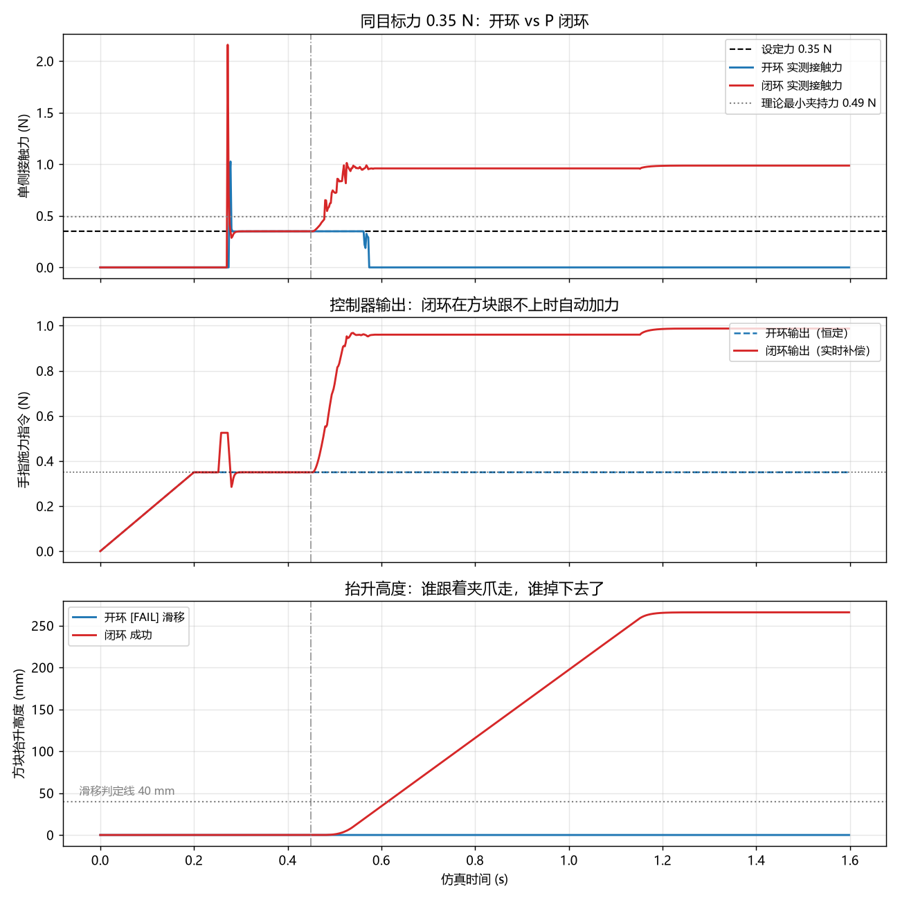

# 夹持力低于临界值时为什么会掉

## ——一次开环与闭环力控的仿真对比实验

**摘要**：机械手夹住物体，靠的是摩擦力。摩擦力不够，物体就会滑落。本文用 PyBullet 仿真做了一个对比实验：把夹持力从 0.30 N 加到 2.00 N，观察物体能不能被提起来；再把夹持力故意设到临界值以下，比较"开环（力给定值后不再调整）"与"闭环（检测到滑移就加力）"两种策略。结果显示：0.30 N 和 0.50 N 都会滑落，0.80 N 以上可以稳定提起；而在同样 0.35 N 的设定下，开环掉了、闭环靠 0.99 N 的补偿力夹住了。实验说明，夹持力不是一个"设多少就多少"的常数，而是一个必须留余量的下限问题。

**关键词**：夹持力；摩擦；滑移检测；力控；仿真

---

## 1 问题是怎么来的

两指夹爪夹住一个方块，方块为什么不会掉？

因为两边的指面压着方块，产生了**摩擦力**。要让方块不往下滑，摩擦力必须大于等于重力：

$$2\mu N \ge mg$$

其中 $\mu$ 是摩擦系数，$N$ 是**每根手指**的法向力，$m$ 是方块质量，$g$ 是重力加速度。

把实验参数代进去：$m = 0.100\,\text{kg}$，$\mu = 1.00$，于是

$$N \ge \frac{mg}{2\mu} = \frac{0.100 \times 9.81}{2 \times 1.00} \approx 0.49\,\text{N}$$

**这就是"临界夹持力"：每侧低于 0.49 N，方块理论上一定滑。**

那实际是不是这样？如果夹持力真的低于它，还有没有办法救回来？这就是本实验要回答的两个问题。

## 2 实验设置

全部在 PyBullet 物理仿真里完成，不涉及真实硬件。

| 项目 | 取值 |
|---|---|
| 仿真器 | PyBullet（Bullet 物理引擎） |
| 物体 | 边长 50 mm 的立方体 |
| 质量 | 0.100 kg |
| 摩擦系数 | 1.00（两物体相乘后的有效值） |
| 临界夹持力（单侧） | 0.49 N |
| 抬升方式 | 夹住后竖直上升到约 265 mm |
| 判定标准 | 方块相对夹爪位移 < 40 mm 为"夹住" |

夹爪是两指平行夹爪，用位置控制开到设定开度，实际的接触力从仿真里的接触点读取。

## 3 实验一：开环——力设好了就不管

所谓**开环**，就是夹爪按设定值合上，之后不管发生什么都不再调整。

试验了五组力，每组抬升一次，结果如下：

| 设定力 (N) | 实测保持段 (N) | 抬升高度 (mm) | 结果 |
|---|---|---|---|
| 0.30 | 0.00 | −0.0 | ❌ 滑移 |
| 0.50 | 0.00 | −0.0 | ❌ 滑移 |
| 0.80 | 0.80 | 279.0 | ✅ 成功 |
| 1.20 | 1.20 | 285.0 | ✅ 成功 |
| 2.00 | 2.00 | 285.0 | ✅ 成功 |

两组失败、三组成功，分界线在 0.80 N 附近。

### 3.1 一个值得注意的细节

**0.50 N 明明高于理论值 0.49 N，为什么还是掉了？**

原因是 0.49 N 是**静止状态**下的下限。抬升时物体要向上加速，需要的摩擦力变成

$$2\mu N \ge m(g + a)$$

加速度 $a$ 越大，要求越高。再加上合拢瞬间有冲击、接触点数量不稳定（实验里接触点从 2 个到 7 个都有），实际需要的力会比静态计算值高不少。

**结论：理论下限只是"及格线"，工程上必须留余量。** 本例中安全余量至少要留到 0.80 N，约为理论值的 1.6 倍。

## 4 实验二：闭环——掉了就赶紧加力

闭环的思路是：不预设一个固定的力，而是**盯着有没有滑**，滑了就加力。

控制器用两部分：

- **比例项**：$F = F_0 + K_p (F_{target} - F_{measured})$，让实测力跟上目标
- **滑移补偿项**：检测到物体相对位移超过阈值，就叠加 $K_{slip} \times \Delta d$ 的补偿力

参数：初始目标 0.35 N（**故意设得低于 0.49 N 的临界值**），$K_p = 0.5$，$K_{slip} = 0.05\,\text{N/mm}$，输出上限 5.0 N。

结果：

| 策略 | 指令力 (N) | 实测保持段 (N) | 抬升高度 (mm) | 结果 |
|---|---|---|---|---|
| 开环 | 0.35 | 0.00 | −0.0 | ❌ 滑移 |
| 闭环 | 0.99 | 0.99 | 265.9 | ✅ 成功 |

**同样从 0.35 N 出发，开环掉了，闭环把自己"抢救"了回来。**

从曲线（图 1）能清楚看到这个过程：

- 0 到 0.45 s：两条线都是 0.35 N，方块还没滑
- 约 0.5 s：方块开始下滑，开环的接触力直接掉到 0；闭环的控制器察觉位移，指令力快速爬升
- 0.6 s 之后：闭环稳定在 0.99 N，方块跟着夹爪升到 265.9 mm



*图 1　三条曲线自上而下分别是：实测接触力、控制器输出、方块抬升高度。虚线为 0.35 N 设定力与 0.49 N 临界力。*

## 5 讨论

### 5.1 闭环到底解决了什么

它解决的**不是"夹得更紧"，而是"不知道物体多重时也能夹住"**。

如果一开始就知道方块要 0.8 N 才夹得住，直接设 0.8 N 就行，根本不需要闭环。闭环的价值在于：**面对未知物体，不用人工试错。** 这在真实产线上很关键——来料重量、表面状态每次都不同。

### 5.2 闭环的代价

第一，**响应有延迟**。从开始滑到力补上去，中间那段方块是往下掉的，掉多少取决于采样率和电机响应速度。

第二，**会超调**。目标是 0.35 N，最后稳定在 0.99 N，接近 3 倍。如果夹的是鸡蛋、果冻这种软东西，这个超调就可能把东西捏坏。

第三，**依赖滑移检测**。检测不到滑移（比如物体很轻、或者传感器分辨率不够），闭环就等于没开。

### 5.3 什么情况下该用哪种

| 场景 | 建议 |
|---|---|
| 物体固定、批量生产 | 开环 + 足够大的固定力，简单可靠 |
| 来料不确定、易损 | 闭环，但要限制上冲速度，避免捏坏 |
| 高速节拍 | 开环为主，闭环只做安全兜底 |

## 6 结论

1. 夹持力存在一个**理论下限**（本例 0.49 N），低于它必然滑落；但工程上要按**动态工况**取余量，本例实际需要 0.80 N。
2. **开环**在力设低时必然失败，且失败是"一开始就注定"，不是参数没调好。
3. **闭环**能把失败的抓取救回来（0.35 N 设定 → 0.99 N 实际），代价是响应延迟和超调。
4. 选开环还是闭环，取决于**物体是否已知**和**是否允许超调**，而不是哪个更先进。

## 7 局限与可改进的地方

- 摩擦系数取了常数 1.00，真实物体滑起来后静摩擦会掉到动摩擦，需求力更大
- 没有考虑物体**转动**，真实抓取中偏心会带来力矩
- 只测了单次抬升，样本量小，重复性未统计
- 闭环只用了最简单的 P + 滑移补偿，没做积分项和限幅整形

**下一步可以做**：同一物体重复 20 次统计成功率；把摩擦系数改成 0.3（模拟光滑塑料）看临界值怎么变；给闭环加力上升速率限制，观察超调是否下降。

---

## 附：复现方式

```bash
pip install pybullet numpy matplotlib -i https://pypi.tuna.tsinghua.edu.cn/simple
python 03_力控对比.py      # 开环五组力
python 04_闭环力控.py      # 开环 vs 闭环
```

原始运行记录见同目录 `结果_开环.txt`、`结果_闭环.txt`。
